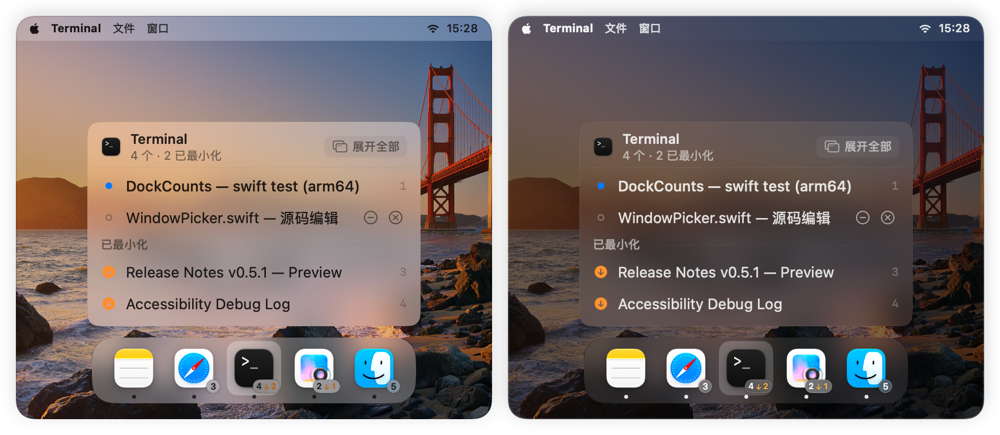

<p align="center">
  
</p>

<h1 align="center">DockCounts</h1>

<p align="center">
  <a href="README.md">English</a> · <a href="README.zh-CN.md">简体中文</a>
</p>

<p align="center">
  补齐 macOS 程序坞（Dock）与 <code>⌘Tab</code> 的切窗短板：多窗口点按精准选窗、前台单窗口再次点按即最小化、轻量角标按需显示窗口与最小化数、<code>⌘Tab</code> 切到已最小化或零窗口应用自动恢复 / 新建。
</p>

<p align="center">
  
</p>

---

## 解决什么痛点

| 原生 macOS 痛点 | DockCounts 效果 |
| --- | --- |
| 多个窗口缩进 Dock 图标，看不出开了几个、哪些已最小化 | **简洁角标**仅在多窗或含最小化时显示 `3` / `3↓1`，单窗口时自动隐藏、无干扰 |
| 点按 Dock 多窗口行为模糊，点按前台单窗口没反应 | **Dock 点按增强**：多窗口直出选窗菜单（支持 `1–9` 快捷键与悬停关/藏），前台单窗口再次点按即最小化；菜单已开时再点同一图标可按开关选择执行原生恢复/切回或仅关闭菜单 |
| `⌘Tab` 切到全部最小化或零窗口应用，只换菜单栏不动窗口 | **`⌘Tab` 切换增强**：自动恢复最小化窗口（多窗弹出居中菜单），零窗口应用通过 Dock 原生 `reopen` 自动新建窗口 |

## 核心特性

- **Dock 点按增强**：默认在多窗口时点按 Dock 图标弹出窗口清单（可切换为含单窗口），按「当前主窗口 → 展开窗口 → 已最小化」分组，支持 `1–9` / 方向键直选、悬停行内最小化或关闭、一键「展开全部」；单窗口处于前台时再次点按直接最小化；可配置菜单已开时再次点按同一图标执行原生行为或仅关闭菜单。
- **`⌘Tab` 切换增强**：切到全部窗口已最小化的应用时自动恢复单窗（多窗弹出屏幕居中菜单或恢复最近窗）；切到零窗口常规应用时通过系统 Dock `AXPress` 原生触发新建默认窗口，并结合 `activeSpaceDidChange` 与当前屏可见窗口数严格避免跨 Space 误判。
- **简洁无干扰角标**：默认在单窗口正常状态时自动隐藏；纯多窗口呈紧凑正圆单数字（如 `3`），含最小化呈 `3↓1`。提供系统玻璃、柔和磨砂、高对比纯色、系统主题色四套风格与紧凑/标准两档尺寸。
- **统一外观与双语切换**：支持统一控制角标、窗口菜单与设置窗口的外观模式（跟随系统 / 浅色 / 深色），以及简体中文 / English 实时切换，设置按「通用 / 增强 / 外观 / 关于」清晰分组。
- **原生轻量、手动检查更新**：系统原生 `.menu` 菜单栏；`CGEventTap` 回调仅做本地几何与 WindowServer 层级判定，不阻塞输入；右键、修饰键点按与拖动（> 5 pt）保留系统原样。无屏幕采集、无后台联网、无遥测，仅在设置页主动点击「检查更新」时查询 GitHub Releases。

## 下载与安装

1. 前往 [GitHub Releases](https://github.com/whdichrn/DockCounts/releases) 下载最新通用版压缩包 `DockCounts-0.5.1-universal.zip`（支持 Apple Silicon 与 Intel，系统要求 macOS 15+）。
2. 解压后将 `DockCounts.app` 拖入 `/Applications`（应用程序）目录并启动。
3. 在 **系统设置 → 隐私与安全性 → 辅助功能** 中允许 `DockCounts`。
   > **提示**：公开下载包使用 ad-hoc 签名，跨版本覆盖升级后若系统提示未授权，请在辅助功能列表中移除旧记录并重新勾选 `/Applications/DockCounts.app`。从源码本地构建时脚本会自动使用本机开发证书签名，后续更新无需重复授权。
4. 可按需在 **系统设置 → 桌面与程序坞** 中开启「将窗口最小化至应用程序图标」。

## 构建与测试

环境要求：macOS 15+、Xcode 16 或更新版本（Swift 6 工具链）。修改 SVG 后重新生成图标资源需安装 `librsvg`（`rsvg-convert`）。

```sh
# 1. 运行单元测试（无需桌面交互权限）
swift test

# 2. 构建本机架构 .app
scripts/build-app.sh

# 或构建 Apple Silicon + Intel 通用版本
DOCKCOUNTS_UNIVERSAL=1 scripts/build-app.sh

# 3. 从 Artwork/*.svg 重新生成图标与菜单栏 PDF 资源（需 librsvg）
scripts/generate-icons.sh
```

需要真实桌面会话与辅助功能权限的集成测试（运行前请先退出已有 `DockCounts`）：

```sh
DOCKCOUNTS_TEST_MENU=1 scripts/test-live.sh
```

## 实现与权限边界

- Apple 的 `NSDockTile` 仅适用于本应用自身图标，无法为其他应用写入角标；角标层使用忽略鼠标事件的透明 `NSPanel` 跟随辅助功能 API 暴露的 Dock 图标坐标。
- 窗口清单读取自系统辅助功能树（`AXUIElement`），对跨 Space、全屏或特殊框架应用的窗口可见性取决于应用自身公开的辅助功能信息。
- `scripts/build-app.sh` 会优先自动使用本机钥匙串中可用的 `Developer ID Application` / `Apple Development` / `DockCounts` 代码签名证书（也可通过 `DOCKCOUNTS_SIGN_IDENTITY` 指定，传 `-` 强制 ad-hoc）；CI 与无证书环境自动回退到 ad-hoc 签名。

## License

基于 [MIT License](LICENSE) 开源。
