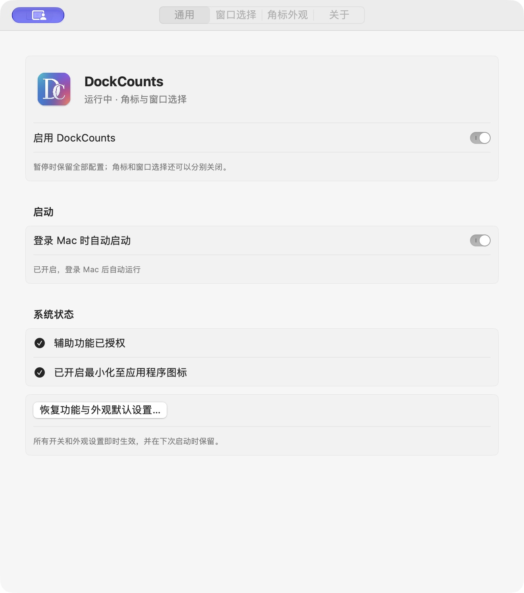
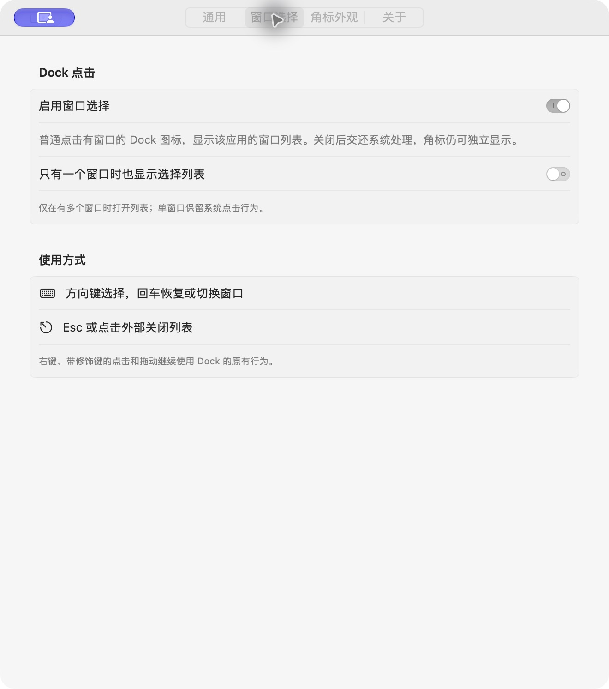
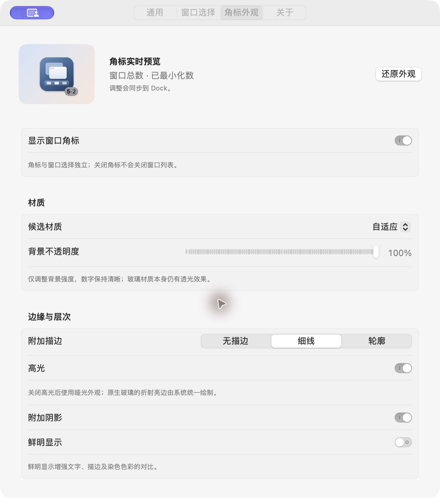
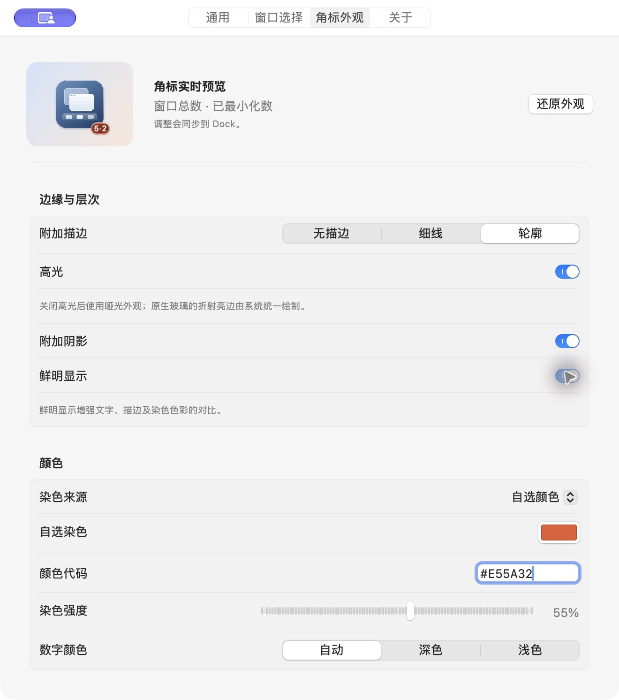
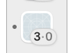
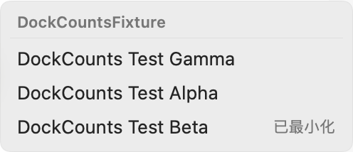
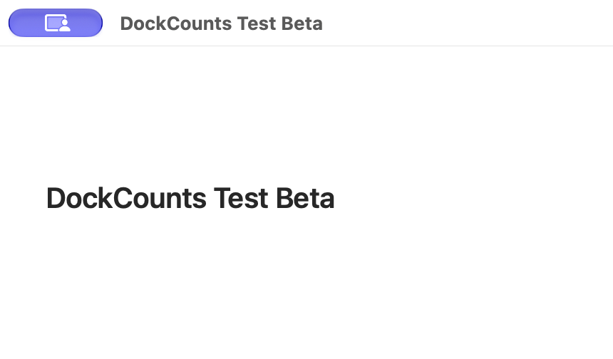
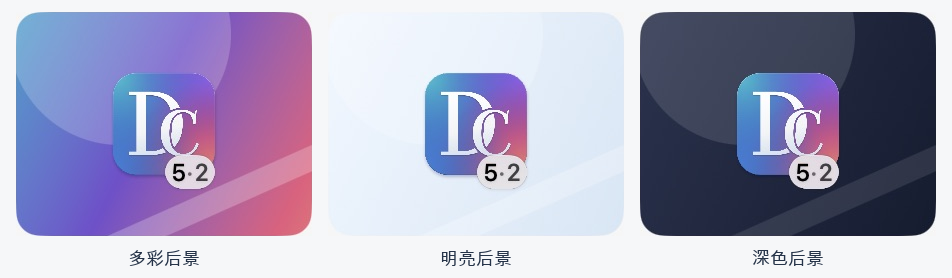

# DockCounts 0.4.2 实机图解

[下载四页 PDF 手册](https://github.com/whdichrn/DockCounts/releases/download/v0.4.2/DockCounts-0.4.2-Quick-Guide-zh-CN.pdf) · [下载软件通用版](https://github.com/whdichrn/DockCounts/releases/download/v0.4.2/DockCounts-0.4.2-universal.zip)

多彩后景、关于页和新版通用设置截图来自本机运行的 **0.4.2 安装版**，其他功能设置局部沿用 0.4.0 实机图。下方计数、Dock 与恢复窗口局部沿用 0.3 实机图，窗口菜单局部沿用 0.2 实机图；本轮已重新验证真实窗口、菜单内容和恢复行为。菜单栏字形示意来自 0.4.1 安装包的原始矢量资源；其他实机图片只裁切相关区域，没有重绘界面。截图机为 macOS 27.2.1，软件最低支持 macOS 15。

## 按需开启功能

从菜单栏打开“设置…”，可看到通用、窗口选择、角标外观和关于四页。

- **通用**：总开关暂停整个工具，保留各项配置；“登录 Mac 时自动启动”独立设置，真实状态由系统管理。
- **窗口选择**：可单独关闭；“只有一个窗口时也显示选择列表”关闭后，单窗口点击使用 Dock 的原有行为，多个窗口仍可选择。
- **角标外观**：可单独关闭角标，窗口列表继续工作；关闭功能时也能预览和调整外观。
- **关于**：查看版本，打开项目主页或版本下载页。





所有功能及外观设置即时保存，退出重开会恢复。开机启动默认关闭；恢复功能与外观默认设置不会改变系统登录项。

## 调整角标外观

默认使用中性染色和细描边，与 Dock 的系统材质协调。材质可选自适应、柔和玻璃、清透玻璃、哑光磨砂、纯色；自适应会响应系统“减弱透明效果”。



“背景不透明度”只改变背景，数字保持清楚。可选择无描边、细线或轮廓，分别打开高光、附加阴影与鲜明显示。关闭高光后使用哑光外观，原生玻璃自身的折射亮边由系统统一绘制。

染色可选中性、系统主题色、自选颜色或无染色；自选颜色支持系统色板或输入六位颜色代码，例如 `#E55A32`。染色强度独立可调，数字颜色支持自动、深色和浅色。向下滚动可看到全部颜色设置。



点击“还原外观”仅重置角标样式。关于页的项目主页仍是私有仓库，需要有访问权限的 GitHub 账户。

## 角标怎么看

图标右下角的小型磨砂计数中，前面的数字是窗口总数，后面的数字是已最小化数。两项使用中性色与不同文字层级，总数包含已最小化窗口。右上角保留给应用自身的通知角标。

| 恢复前：3·1 | 恢复后：3·0 |
| --- | --- |
|  |  |

演示应用共有 Alpha、Beta、Gamma 三个窗口。选择最小化的 Beta 后，角标从 `3·1` 更新为 `3·0`，总窗口数仍然是 3。

## 点击 Dock 图标后


菜单只列出这个应用的窗口名称和最小化状态。菜单采用系统菜单材质、紧凑间距与随内容调整的宽度。打开时不预选窗口；鼠标悬停或方向键选择后才显示系统高亮，带“已最小化”的行可以直接恢复并切换。



## 选择 Beta 后的实际窗口



已实测窗口恢复、成为前台焦点窗口，以及角标更新。没有窗口预览功能。

## 三步上手

1. 从私有发布页下载 ZIP，解压，将 `DockCounts.app` 放到固定位置，例如 `~/Applications`，双击启动。
2. 在“系统设置 → 隐私与安全性 → 辅助功能”允许 DockCounts；在“桌面与程序坞”开启“将窗口最小化至应用程序图标”。当前这台电脑已经设置完成。
3. 普通点击有窗口的 Dock 应用图标，选择所需窗口。

| 操作 | 结果 |
| --- | --- |
| 方向键 ↑ / ↓ | 选择窗口 |
| 回车 | 恢复并切换到选中窗口 |
| Esc 或点击外部 | 关闭菜单 |
| 右键或带修饰键的点击 | 保留系统原有行为 |

菜单栏的这个图标可打开设置、暂停或退出：


当前版本使用本地 ad-hoc 签名，未做 Developer ID 公证。重新构建或签名后，如果旧的辅助功能授权失效，请移除旧记录，再添加当前安装包。不同应用的窗口数量取决于它们提供的辅助功能信息。

## 重新生成 PDF

在 macOS 上安装 `reportlab` 与 `Pillow` 后运行：

```sh
python3 scripts/build_manual.py
```

输出为 `output/pdf/DockCounts-0.4.2-Quick-Guide-zh-CN.pdf`。PDF 使用截图目录中的原始局部图，并嵌入中文字体。

## 0.4.2 更新

应用图标以同一衬线 DC 字形重做，使用青蓝、紫色与珊瑚色渐变。设置窗口固定大小，禁用最小化、缩放、填满和全屏。


角标实时预览可切换多彩、明亮、深色后景；只影响预览，不会更改桌面或实际角标的外观参数。以下使用同一组材质参数，仅切换预览后景：



## 0.4.1 更新

采用已选定的方案 B：D、C 统一衬线体，C 缩小并位于右下方交错。菜单栏图标为单色模板，自动跟随系统明暗外观。字形以纯矢量路径保存，避免遮罩导出成低分辨率图片。

## 0.3.0 更新

补齐 App 图标和单色菜单栏图标；角标在桌面与 Dock 过渡中复用面板，使用独立的位置跟踪与短暂失败容错。macOS 26+ 在减弱透明效果下使用保留模糊的清晰玻璃配方。

详细测试方式和已验证范围见 [0.4.2 验证记录](../0.4.2-validation.md)。
