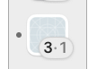
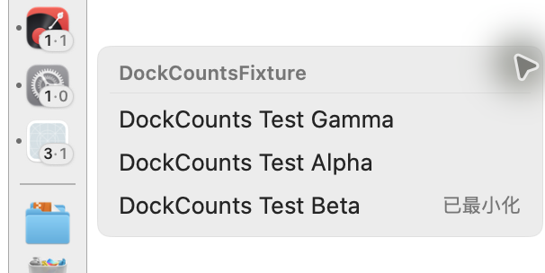

# DockCounts 0.2.0 实机图解

[下载两页 PDF 手册](https://github.com/whdichrn/DockCounts/releases/download/v0.2.0/DockCounts-0.2.0-Quick-Guide-zh-CN.pdf) · [下载软件通用版](https://github.com/whdichrn/DockCounts/releases/download/v0.2.0/DockCounts-0.2.0-universal.zip)

以下截图来自本机正在运行的 **0.2.0 安装版**，使用专用测试应用和窗口，只裁切相关区域，没有重绘界面。截图机为 macOS 27.2.1，软件最低支持 macOS 15。

## 角标怎么看

图标右下角的小型半透明计数中，前面的数字是窗口总数，后面的数字是已最小化数。两项使用中性色与不同文字层级，总数包含已最小化窗口。右上角保留给应用自身的通知角标。

| 恢复前：3·1 | 恢复后：3·0 |
| --- | --- |
|  |  |

演示应用共有 Alpha、Beta、Gamma 三个窗口。选择最小化的 Beta 后，角标从 `3·1` 更新为 `3·0`，总窗口数仍然是 3。

## 点击 Dock 图标后



菜单只列出这个应用的窗口名称和最小化状态。菜单采用系统菜单材质、紧凑间距与随内容调整的宽度。打开时不预选窗口；鼠标悬停或方向键选择后才显示系统高亮，带“已最小化”的行可以直接恢复并切换。


## 选择 Beta 后的实际窗口


已实测窗口恢复、成为前台焦点窗口，以及角标更新。没有窗口预览功能。

## 三步上手

1. 从私有发布页下载 ZIP，解压，将 `DockCounts.app` 放到固定位置，例如 `~/Applications`，双击启动。
2. 在“系统设置 → 隐私与安全性 → 辅助功能”允许 DockCounts；在“桌面与程序坞”开启“将窗口最小化至应用程序图标”。当前这台电脑已经设置完成。
3. 普通点击有窗口的 Dock 应用图标，选择所需窗口。

| 操作 | 结果 |
| --- | --- |
| 方向键 ↑ / ↓ | 选择窗口 |
| 回车 | 恢复并切换到选中窗口 |
| Esc 或点击外部 | 关闭菜单 |
| 右键或带修饰键的点击 | 保留系统原有行为 |

菜单栏的这个图标可打开设置、暂停或退出：


当前版本使用本地 ad-hoc 签名，未做 Developer ID 公证。重新构建或签名后，如果旧的辅助功能授权失效，请移除旧记录，再添加当前安装包。不同应用的窗口数量取决于它们提供的辅助功能信息。

## 重新生成 PDF

在 macOS 上安装 `reportlab` 与 `Pillow` 后运行：

```sh
python3 scripts/build_manual.py
```

输出为 `output/pdf/DockCounts-0.2.0-Quick-Guide-zh-CN.pdf`。PDF 使用截图目录中的原始局部图，并嵌入中文字体。
